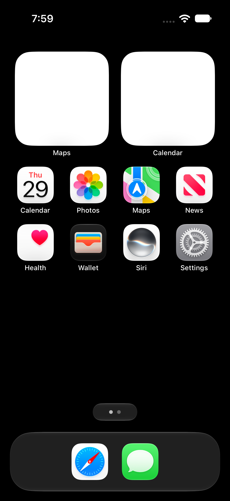
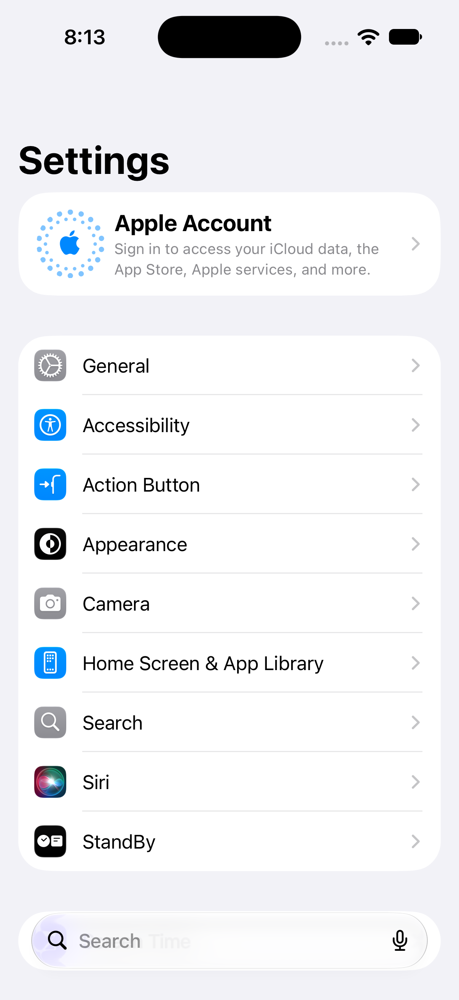
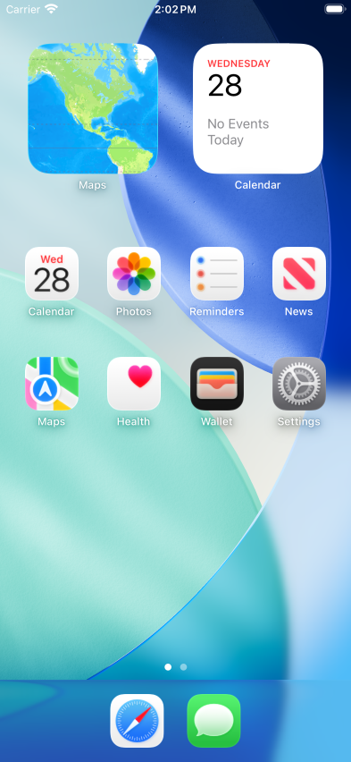
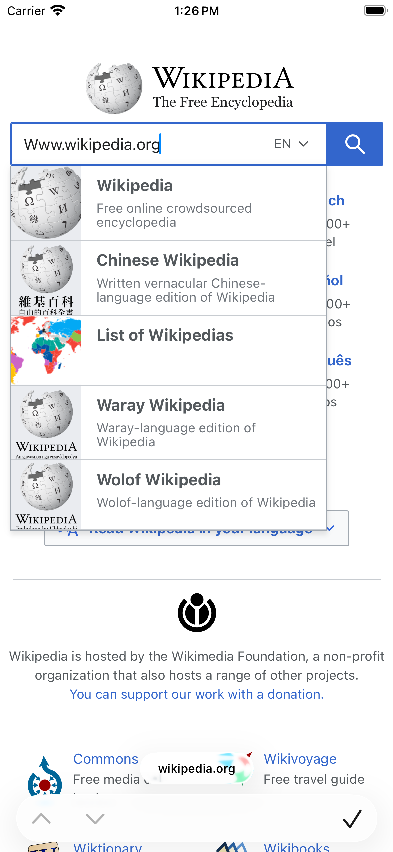

# x86code

**Run Apple's iOS Simulator on a regular Linux PC. No Mac required.**

x86code boots the real iOS 27 simulator, Apple's own unmodified system, on an everyday x86-64 Linux machine. You get
the home screen, apps like Settings, and touch input, rendered on your own graphics card.

<p>


</p>

> **Early days.** It works and it's getting quick: about 20 seconds to boot and a few seconds to open an app. Memory is
> what we're working on now.

## Where things stand

| | |
|---|---|
| ✅ Boots to the home screen | about 16–22 s |
| ✅ Graphics on your GPU | Metal → Vulkan, including iOS 27's glass dock and search bar |
| ✅ Touch and gestures | click and drag in the viewer window |
| ✅ Apps open and scroll | Settings scrolls at ~60 fps; an app opens in ~3.5–4 s cold, under 1 s warm |
| ✅ Quiet when idle | about 1% of one CPU core |
| 🚧 Memory | about 2.5 GB at the home screen for one phone alone (~1.5 GB more per extra phone), ~4 GB with Maps open; the goal is under 1 GB |
| 🚧 Off by default | wallpaper and widgets (they cost ~1 GB); turn them on per phone in the launcher |

## How it works

Apple only ships the iOS 27 simulator for Apple-silicon (arm64) Macs. A Linux PC speaks x86-64, so x86code
**translates iOS's arm64 code to x86-64 on the fly**, a bit like Rosetta 2 in reverse.

- **[Darling](https://github.com/darlinghq/darling)** provides the macOS-style system underneath: processes, Mach
  messaging and the file system. We extended it for the iOS simulator.
- **[dynarmic](https://github.com/azahar-emu/dynarmic)**, a fast arm64 translator from the emulator world, runs each iOS
  process. Our fork adds the instructions iOS needs and shares translated code across a process's threads.
- **System calls skip translation.** iOS 27 never talks to the kernel directly. It goes through three system libraries,
  and ours hand those calls straight to native x86 code.
- **Graphics, touch and networking** go to small native Linux services. Metal drawing becomes Vulkan on your GPU.

On the way to "feels native":
1. Native fast paths for the busiest iOS functions.
2. Keeping translated code between launches.
3. Translating all of iOS's system libraries ahead of time, once.

The design and every measurement are in [docs/notebook/ARM64-PLAN.md](docs/notebook/ARM64-PLAN.md).

## Try it

Do the one-time setup below first (no Mac needed). Then start a phone from the launcher
(`tools/launcher/target/release/x86code-launcher`), or from a shell:

```sh
# boot iOS 27 (uses the GPU; A64_JOBS=slim|std|full picks how much of iOS starts)
X86CODE_METAL=all A64_KEEP=1 cli/libexec/arm64/boot-a64.sh

# open the viewer window; the mouse is your finger
DISPLAY=:0 SIMFB_RING_LINUX=/dev/shm/x86code-a64-simfb.ring \
  SIMHID_SOCKET=$PWD/var/device-a64/data/simhid.sock cli/libexec/simview.py
```

It runs in its own sandboxed container, with caps on disk and memory use so it can't bog down your PC.

## Also in here: iOS 26.5, natively

Before iOS 27, the project ran Apple's last x86-64 simulator, **iOS 26.5**, directly with no translation needed. That
version is much further along: Safari, Maps, News, your own apps, simctl-style tools, LLDB debugging, 27-second boots
and smooth 60 fps. It still works and is frozen as-is. Most of the command reference below (`x86sim …`) is for it.

<p>



</p>

## More reading

- [ARM64-PLAN.md](docs/notebook/ARM64-PLAN.md): the iOS 27 design, stage by stage, with measurements
- [ARCHITECTURE.md](docs/ARCHITECTURE.md): how the pieces fit together
- [WORKAROUNDS.md](docs/WORKAROUNDS.md): what's faked or approximated, honestly
- [FINDINGS.md](docs/notebook/FINDINGS.md): the full lab notebook

## Requirements

- **Linux x86-64** with a recent kernel. Darling needs its usual setup: FUSE/overlayfs and a setuid-root `darling`
  binary.
- **A Vulkan GPU**: NVIDIA (proprietary driver) or AMD (RADV), with `VK_EXT_external_memory_host`. Development used an
  NVIDIA RTX 5090. Without a usable GPU, `X86CODE_METAL=0` falls back to software rendering.
- **Darling's build dependencies**: clang/LLVM, cmake, ninja, bison, flex, FUSE, libcap, Python 3, and the rest of
  Darling's [build list](https://docs.darlinghq.org/build-instructions.html); dynarmic also needs boost headers.
- **Rust** (stable, via rustup) for `linux/mtlvk` and metal2vulkan.
- **Python 3** with `PIL` (Pillow) and `dnspython`. The viewer needs PyGObject with GTK 4, the stream needs `ffmpeg`
  (NVENC), `x86sim dismiss` needs `tesseract`, `x86sim site` needs `cloudflared`, and `x86sim debug` needs `lldb`.
- **Apple's iOS 27 simulator runtime**, not included: `runtime-fetch.py` downloads it straight from Apple's catalogue
  (no Mac, no Apple ID). It needs [`ipsw`](https://github.com/blacktop/ipsw) and 7-Zip. iOS 26.5 (23F73, universal) for
  the frozen x86_64 path still comes from Xcode on a Mac (see below).
- **No Mac to run it.** The simulator-side binaries in `host/` and `tests/` are committed. Rebuilding them works on
  Linux with Apple's SDKs copied once into `sdks/` (see *Simulator-side binaries*); only Metal shader sources still need
  a Mac to compile.

## Layout

```
cli/        x86sim front end; cli/libexec: the scripts it wraps; cli/lib: configuration
host/       simulator-side services (Mach-O, run inside Darling): simhost, simfb, simhid, iosurfaced,
            metalhostd (+ vkmtl), fpsim2host, fseventsd, netconfig, openurl, simshim/{compat,diag}
linux/      native Linux pieces: arm64jit (the JIT host library), mtlvk (Rust, Metal on Vulkan), mdnsd, hostnet
tests/      sample apps (tests/apps, apps.sh), probes (tests/probes), Metal (mtlprobe + shaders) and IOSurface (iosprobe) tests, smoke test
tools/      debug/: core dumps, stacks, stuck processes, Darling install (dinstall.sh), container cleanup;
            runtime/extract-runtime.py: Apple's runtime image -> RuntimeRoot on Linux
build/      build scripts (mac-build-*.sh) for the host/ and tests/ binaries: on Linux by default (linux-env.sh), or a Mac
docs/       ARCHITECTURE, WORKAROUNDS, METAL, protocols/, REPOS, notebook/ (FINDINGS lab notebook), screens/
external/   git submodules: darling, dynarmic and metal2vulkan (x86code branches of the x86code forks)
```

## Setup

Pre-built: the AppImage from the GitHub pre-releases sets itself up (host checks, Darling, iOS download, first
phone) from the launcher's Setup page; see [docs/RELEASE.md](docs/RELEASE.md). From source:

1. **Clone with submodules.**
   ```sh
   git clone --recursive https://github.com/x86code/x86code.git && cd x86code
   cp x86sim.env.example x86sim.env      # then edit if needed: paths, GPU settings
   ```
2. **Get the iOS 27.2 runtime** straight from Apple (about 8 GB download, ~23 GB unpacked):
   ```sh
   cli/libexec/arm64/runtime-fetch.py list            # iOS 27.x runtimes in Apple's catalogue
   cli/libexec/arm64/runtime-fetch.py fetch 24B8117   # iOS 27.2 -> runtimes/ios-27.2-24B8117-arm64/
   echo ios-27.2-24B8117-arm64 > var/device-a64/runtime
   ```
   It decrypts Apple's archive (`ipsw`), unpacks the APFS image (`7z`), and remakes every symlink 7-Zip gets wrong
   (`tools/runtime/extract-runtime.py --links`, then `--check`).
3. **Build and install Darling** (bin/darling must be setuid root, so this asks for sudo):
   ```sh
   make darling-install                  # configures external/darling -> $X86SIM_PREFIX, builds, installs
   ```
4. **Build the Linux pieces:**
   ```sh
   make mtlvk                            # Metal on Vulkan
   linux/arm64jit/install.sh             # the arm64 JIT, installed into Darling
   (cd tools/launcher && cargo build --release)   # launcher, x86code-aot, x86code-mcp
   ```
5. **Pre-translate** (optional, much faster boots and app opens):
   `tools/launcher/target/release/x86code-aot --device $PWD/var/device-a64 build --full`, or the launcher's
   Pre-translate page.
6. **Boot:** from the launcher, or `X86CODE_METAL=all A64_KEEP=1 cli/libexec/arm64/boot-a64.sh` (see *Try it*).

The x86_64 iOS 26.5 path (`cli/x86sim boot`) needs that runtime from Xcode on a Mac:
`xcodebuild -downloadPlatform iOS -buildVersion 26.5 -architectureVariant universal -exportPath ~/simrt`, copied to
`runtimes/ios-26.5-23F73-universal/` and unpacked with
`tools/runtime/extract-runtime.py runtimes/ios-26.5-23F73-universal runtimes/ios-26.5-23F73-universal/extracted`.

Commands that need root (installing Darling, killing the setuid `darling` launcher, cores) read the password from
`SUDO_PASS` in the environment or use sudo's prompt or cache. The password is never stored in a file.

## Usage (iOS 26.5 x86_64 path)

```sh
x86sim boot                     # boot the standard device in the background, wait for the home screen
x86sim view [--bg]              # GTK window: mouse = touch, Ctrl/Shift+drag = two fingers, F1 = home
x86sim tap 590 1300             # device pixels (1179x2556)
x86sim swipe 900 1500 200 1500  # also: pinch, pan2, key, type "text", home, lock
x86sim openurl https://example.com
x86sim app com.apple.Preferences
x86sim install MyApp.app        # an iOS-simulator build (x86_64 slice), as xcrun simctl install: icon on the home screen
x86sim launch com.example.myapp -arg value   # as simctl launch; also: x86sim uninstall com.example.myapp
SIMCTL_CHILD_FOO=bar x86sim launch --console --terminate-running-process com.example.myapp   # env + stdout/stderr here
x86sim launch --console-pty com.example.myapp      # the same through a pty (isatty in the app, as simctl)
x86sim location set 48.8584,2.2945                 # simulated location (CLLocationManager, Maps' blue dot)
x86sim location start --speed=30 37.3349,-122.0090 37.3317,-122.0302   # drive along waypoints; `location list|run "Freeway Drive"|clear`
x86sim terminate com.example.myapp
x86sim get_app_container com.example.myapp data   # app | data | groups | <group id> (Linux paths)
x86sim listapps                 # installed apps (--json: bundle/data paths, executable, version)
x86sim push com.example.myapp payload.json   # simulated remote notification ("aps" payload, as simctl push)
x86sim addmedia photo.jpg clip.mov           # into the Photos library
x86sim log stream --app com.example.myapp    # the app's os_log (relaunched; --match TEXT filters)
x86sim io recordVideo --secs 10 out.mp4      # also: x86sim io screenshot out.png
x86sim debug --launch com.example.myapp      # LLDB attached before main (see Debugging)
x86sim dismiss                  # answer permission prompts on screen (OCR)
x86sim screenshot shot.png 3    # newest frame, scaled down 3x
x86sim stream                   # 60 fps HLS stream into $X86SIM_SITE/live
x86sim site                     # progress page + stream + http server (:8765) + cloudflared quick tunnel
x86sim status | logs [label] | fps 10
x86sim smoke                    # boot -> home screen -> Settings, Safari -> screenshot checks
x86sim apps                     # install + launch the sample apps (tests/apps), check that they draw
tests/devtools.sh               # the developer commands above with the DevTools test app (16 checks)
tests/perf.py all               # short performance run: idle CPU/wakeups/RSS per process, launch times, scroll frame
                                # times (p50/p95/p99) and touch->frame latency (seconds each; see FINDINGS 3.18)
x86sim probe metal|iosurface    # minimal devices with the Metal / IOSurface test clients
x86sim apptest out/             # open each app, answer prompts, screenshot, collect crashes
x86sim shutdown
```

Useful environment variables: `X86CODE_METAL=all|0|proc,...` (GPU for every process / software rendering / only the
listed processes), `X86CODE_NODT=all,-<label>` (os_log for one job), `X86CODE_INSERT=host/simshim/diag/libsyncdiag.dylib`
(diagnostic shims, built with `make mac-diag`), `X86CODE_MDNS=0`, `X86CODE_SEEDPERMS=0`. Debugging: `tools/debug/`
(`lastcrash.sh`, `stuck.sh <process>`, `allstacks.sh`, `sigctx.py`) and [docs/notebook/FINDINGS.md](docs/notebook/FINDINGS.md).

## Debugging

Apps are debugged with **LLDB on Linux** (your distribution's `lldb` package) through LLVM's **debugserver running inside
the Darling container** (`make mac-debugserver` builds it on the Mac from llvm-project sources: Xcode 26+ ships an
arm64-only debugserver). `x86sim debug` starts debugserver attached to the app and LLDB connected to it:

```sh
x86sim debug --launch com.x86code.devtools   # relaunch stopped before main (x86sim launch -w) and attach
x86sim debug com.x86code.devtools            # attach to the running app
x86sim debug --server-only com.x86code.devtools   # only debugserver; prints the lldb command (another terminal, an IDE)
```

```
(lldb) breakpoint set -n '$s8DevTools14ViewControllerC11viewDidLoadyyF'
Breakpoint 1: where = DevTools`$s8DevTools14ViewControllerC11viewDidLoadyyF, address = 0x0000000100002df0
(lldb) continue
* thread #1, queue = 'com.apple.main-thread', stop reason = breakpoint 1.1
(lldb) bt 4
  * frame #0: 0x0000000100002df0 DevTools`$s8DevTools14ViewControllerC11viewDidLoadyyF
    frame #1: 0x00000001000034c5 DevTools`$s8DevTools14ViewControllerC11viewDidLoadyyFTo + 21
    frame #2: 0x00007fd4e1a05241 UIKitCore`-[UIViewController _sendViewDidLoadWithAppearanceProxyObjectTaggingEnabled] + 80
    frame #3: 0x00007fd4e1a0bf26 UIKitCore`-[UIViewController loadViewIfRequired] + 1385
```

Breakpoints by name or regex (`breakpoint set -r 'DevTools.*viewDidLoad'`), continue/step, `bt` with the app's and the
runtime's symbols, registers and memory work, and so do expressions in C and Objective-C (they run code in the app):

```
(lldb) expr -l objc -O -- [[[UIApplication sharedApplication] keyWindow] recursiveDescription]
(lldb) expr -l objc -- (int)[(id)[UIApplication sharedApplication] applicationState]
```

Swift expressions (`po self` in a Swift frame) need an LLDB with Swift support (swift.org's toolchain); the
distribution's lldb has none and falls back to Objective-C++. The warning "could not execute support code to read
Objective-C class data" is about the dyld shared cache, which this runtime doesn't use; classes are still found. Use `kill` or `process detach` to end a session. Crashes without a debugger:
`tools/debug/lastcrash.sh` (symbolized core) and `tools/debug/sigctx.py`.

## Simulator-side binaries

The Mach-O files in `host/` and `tests/` (`simhost`, `SimFramebuffer.framework`, `SimulatorHID.framework`,
`libsimshim.dylib`, `iosurfaced`, `metalhostd`, `fpsim2host`, `fseventsd`, `netconfig`, `openurl`, `prefs`, `mtlprobe`,
`iosprobe`, the probes, diagnostic shims and sample apps) are our own code and are committed, so nothing needs building
to run. To rebuild them on Linux, copy Apple's SDKs once into `sdks/` (gitignored, never committed:
`iPhoneSimulator.sdk` and `MacOSX.sdk` from Xcode, plus `swift-6.4.2/` from swift.org and `swift-lib/` from Xcode's
toolchain for the Swift parts; `cargo install apple-codesign` for signing), then run the usual scripts, e.g. `make mac`
and `build/mac-build-arm64-shims.sh`: with `sdks/` present they build locally (`build/linux-env.sh`: clang + ld64.lld,
`build/linux-swiftc.sh`). `X86SIM_BUILD=mac` with `X86SIM_MAC=user@mac` builds on a Mac over ssh instead. Metal shader
sources are the exception: `build/linux-metal.sh` serves recorded Mac-built libraries (`build/metal-cache`) and a changed
shader still needs a Mac. `debugserver` and the 26.5 dyld cache are Mac-only.

## Status of the iOS 26.5 x86_64 path

- Boots to the home screen. Metal composites on the host GPU and the wallpaper, widgets and icons
  render.
- Touch, gestures, keyboard input and the hardware buttons work. Apps open by tap or with `x86sim app`/`openurl`.
- Networking works: Safari loads real pages over HTTPS, Maps loads tiles, News loads articles.
- Settings, Safari, Maps, Photos, News, Health, Calendar, Files, Preview, Reminders, Wallet, Messages, Contacts,
  Passwords, Shortcuts and Spotlight open. Known gaps are in [docs/WORKAROUNDS.md](docs/WORKAROUNDS.md) and the "Open"
  sections of the notebook. Files gets live updates (an FSEvents stand-in on Linux inotify) and hands documents to
  Preview; some daemons are left out.
- **Your own apps run**: `x86sim install` puts an iOS-simulator `.app` (built with `ARCHS=x86_64 -sdk iphonesimulator`)
  on the device through installd, with a data container and a home-screen icon; `x86sim launch` opens it with
  arguments. UIKit, SwiftUI (navigation, animation, URLSession) and MetalKit/SpriteKit apps (MTKView render loop on
  CAMetalLayer, on the GPU) run at 60 fps. Sample apps: `tests/apps`, built on the Mac by `build/mac-build-apps.sh`.
- Developer workflow as with simctl/Xcode: launch with environment and `--console`, `--wait-for-debugger`, terminate,
  containers, listapps, push notifications, Photos media, os_log streaming, screenshots and MP4 recording, and LLDB
  debugging with breakpoints, symbolic backtraces and Objective-C/C expressions (`x86sim debug`), simulated location
  (a point, a route between waypoints, Apple's scenarios) for CLLocationManager and Maps.
- Performance (FINDINGS 3.18, RTX 5090): idle home screen about 4% of one core for the whole stack (simulator,
  Darling, mtlvk, viewer, stream), boot to home screen 27 s, Settings/Safari/Maps/News first frame after 0.4-0.9 s,
  scrolling at a display-paced 60 fps (frame interval p50 16.7 ms, p90 18.6 ms; GPU work per frame p50 ~1 ms;
  touch-to-frame latency p50 ~24 ms). Occasional hitches remain where the simulator's processes are busy in Mach IPC.
- Tests: `tests/devtools.sh` (22 checks), `tests/fsevhist.sh` (FSEvents history across boots, 5 checks), `x86sim apps` (16 checks), `x86sim probe metal` (46/46), `x86sim probe iosurface` (14/14), `x86sim smoke`.

## Licensing

- **Apple's iOS simulator runtime, SDK, Xcode and frameworks are not included and must not be added.** You need your
  own copy, under Apple's license terms. Only interface declarations needed for interoperability were reconstructed
  (for example `host/simfb/SimFramebuffer.h`).
- **Darling** (`external/darling`) is GPL-3.0 with its own component licenses. See its repository.
- **dynarmic** (`external/dynarmic`) is 0BSD.
- **metal2vulkan** (`external/metal2vulkan`) is dual-licensed **GPL-2.0-or-later OR LGPL-3.0-or-later**. Its license
  files are kept. `linux/mtlvk` links it and uses the same terms.
- The rest of this repository is x86code's own work. No license has been chosen yet: the repository is private.

## License

x86Code is free software under the GNU General Public License v3.0 or later (see [LICENSE](LICENSE)). Bundled
components keep their own licenses; see [NOTICE](NOTICE). Apple's iOS runtimes and SDKs are never included: x86Code
downloads the runtime from Apple on your machine.
