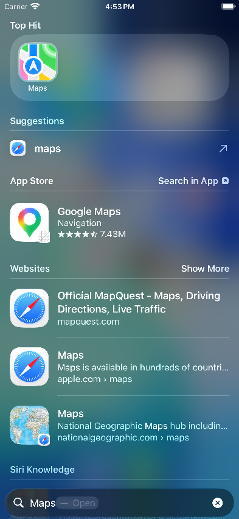
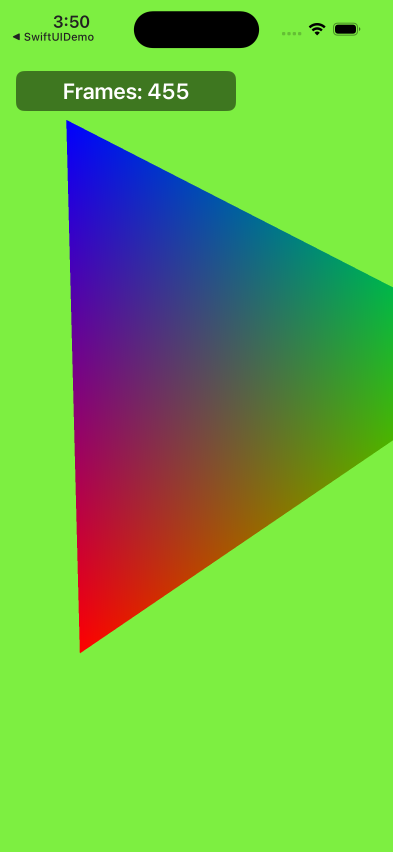

# x86code: the iOS simulator on Linux

x86code boots Apple's **iOS 26.5 simulator runtime** (the x86_64 "universal" runtime, build 23F73) on **x86-64
Linux**. The runtime's binaries are Apple's, unmodified. They run under [Darling](https://github.com/darlinghq/darling),
which we extended for the iOS simulator. The parts a Mac and CoreSimulator normally provide are reimplemented here:
the launchd handshake, the display, touch input, Metal on Vulkan, cross-process IOSurfaces, DNS, network state and
host file services. The home screen, Settings, Safari (with real web pages), Maps, Photos, News, Health, Files,
Preview, Spotlight and the other runtime apps run with GPU rendering.

<p>





</p>

The project is experimental. Read [docs/ARCHITECTURE.md](docs/ARCHITECTURE.md) for how the pieces fit,
[docs/WORKAROUNDS.md](docs/WORKAROUNDS.md) for what is faked or approximated, and
[docs/notebook/FINDINGS.md](docs/notebook/FINDINGS.md) for the full lab notebook.

## Requirements

- **Linux x86-64** with a recent kernel. Darling needs its usual setup: FUSE/overlayfs and a setuid-root `darling`
  binary.
- **A Vulkan GPU**: NVIDIA (proprietary driver) or AMD (RADV), with `VK_EXT_external_memory_host`. Development used an
  NVIDIA RTX 5090. Without a usable GPU, `X86CODE_METAL=0` falls back to software rendering.
- **Darling's build dependencies**: clang/LLVM, cmake, ninja, bison, flex, FUSE, libcap, Python 3, and the rest of
  Darling's [build list](https://docs.darlinghq.org/build-instructions.html).
- **Rust** (stable, via rustup) for `linux/mtlvk` and metal2vulkan.
- **Python 3** with `PIL` (Pillow) and `dnspython`. The viewer needs PyGObject with GTK 4, the stream needs `ffmpeg`
  (NVENC), `x86sim dismiss` needs `tesseract`, `x86sim site` needs `cloudflared`, and `x86sim debug` needs `lldb`.
- **Apple's iOS 26.5 simulator runtime and Xcode**, which are not included: take the iOS 26.5 (23F73) simulator
  runtime image from Xcode on a Mac and extract it (see below). iOS 27 has no x86_64 runtime, so 26.5 is the target.
- **A Mac with Xcode** (reachable over ssh) to compile the small simulator-side binaries in `host/` and `tests/`.
  These are Mach-O files for the iOS simulator SDK, and only Apple's toolchain builds them. Running needs no Mac.

## Layout

```
cli/        x86sim front end; cli/libexec: the scripts it wraps; cli/lib: configuration
host/       simulator-side services (Mach-O, run inside Darling): simhost, simfb, simhid, iosurfaced,
            metalhostd (+ vkmtl), fpsim2host, fseventsd, netconfig, openurl, simshim/{compat,diag}
linux/      native Linux services: mtlvk (Rust, Metal on Vulkan), mdnsd (mDNSResponder), hostnet
tests/      sample apps (tests/apps, apps.sh), probes (tests/probes), Metal (mtlprobe + shaders) and IOSurface (iosprobe) tests, smoke test
tools/      debug/: core dumps, stacks, stuck processes, Darling install (dinstall.sh), container cleanup;
            runtime/extract-runtime.py: Apple's runtime image -> RuntimeRoot on Linux
build/      Mac build scripts (mac-build-*.sh) for the host/ and tests/ binaries
docs/       ARCHITECTURE, WORKAROUNDS, METAL, protocols/, REPOS, notebook/ (FINDINGS lab notebook), screens/
external/   git submodules: darling and metal2vulkan (x86code branches of the designgears forks)
```

## Setup

1. **Clone with submodules.**
   ```sh
   git clone git@github.com:designgears/x86code.git && cd x86code
   make submodules
   cp x86sim.env.example x86sim.env      # then edit: paths, X86SIM_MAC, GPU settings
   ```
2. **Get and extract the runtime.** The runtime Xcode installs by default on Apple silicon is arm64-only; the
   *universal* variant has the x86_64 slices. On a Mac with Xcode 26 or later:
   ```sh
   xcodebuild -downloadPlatform iOS -buildVersion 26.5 -architectureVariant universal -exportPath ~/simrt
   ```
   This downloads iOS 26.5 (23F73, about 10 GB) as an exported bundle with `Restore/iOSSimulatorRuntime_Cryptex.dmg`
   (it also registers the runtime with simctl). Copy the bundle directory to Linux as
   `runtimes/ios-26.5-23F73-universal/`, then extract it there (7-Zip with APFS support, `7z`; about 23 GB):
   ```sh
   tools/runtime/extract-runtime.py runtimes/ios-26.5-23F73-universal runtimes/ios-26.5-23F73-universal/extracted
   ```
   The script runs `7z x -snld` and then makes every symlink of the image again from its listing: 7-Zip writes some
   links as empty files (a link to a link), and absolute links are made relative inside RuntimeRoot.
   `tools/runtime/extract-runtime.py --check ...` compares an extracted tree with the image without changing it.
   The default `X86SIM_RUNTIME` (x86sim.env.example) is that tree's `.../iOS 26.5.simruntime/Contents/Resources/RuntimeRoot`.
3. **Build and install Darling** (bin/darling must be setuid root, so this asks for sudo):
   ```sh
   make darling-install                  # configures external/darling -> $X86SIM_PREFIX, builds, installs
   ```
4. **Build mtlvk:** `make mtlvk`.
5. **Build the simulator-side binaries on the Mac.** Set `X86SIM_MAC=user@mac.local` (ssh key, BatchMode), then run
   `make mac`. This sends the sources over ssh, compiles them with `xcrun -sdk iphonesimulator clang` and copies the
   binaries back next to their sources. Nothing else stays on the Mac. The binaries are not committed. If you have no
   Mac, copy them from a machine that built them: see *Simulator-side binaries* below.
6. **Boot:** `cli/x86sim boot`, then `cli/x86sim view`. Put `cli/` on `PATH` or symlink `cli/x86sim` into `~/bin`.

Commands that need root (installing Darling, killing the setuid `darling` launcher, cores) read the password from
`SUDO_PASS` in the environment or use sudo's prompt or cache. The password is never stored in a file.

## Usage

```sh
x86sim boot                     # boot the standard device in the background, wait for the home screen
x86sim view [--bg]              # GTK window: mouse = touch, Ctrl/Shift+drag = two fingers, F1 = home
x86sim tap 590 1300             # device pixels (1179x2556)
x86sim swipe 900 1500 200 1500  # also: pinch, pan2, key, type "text", home, lock
x86sim openurl https://example.com
x86sim app com.apple.Preferences
x86sim install MyApp.app        # an iOS-simulator build (x86_64 slice), as xcrun simctl install: icon on the home screen
x86sim launch com.example.myapp -arg value   # as simctl launch; also: x86sim uninstall com.example.myapp
SIMCTL_CHILD_FOO=bar x86sim launch --console --terminate-running-process com.example.myapp   # env + stdout/stderr here
x86sim launch --console-pty com.example.myapp      # the same through a pty (isatty in the app, as simctl)
x86sim location set 48.8584,2.2945                 # simulated location (CLLocationManager, Maps' blue dot)
x86sim location start --speed=30 37.3349,-122.0090 37.3317,-122.0302   # drive along waypoints; `location list|run "Freeway Drive"|clear`
x86sim terminate com.example.myapp
x86sim get_app_container com.example.myapp data   # app | data | groups | <group id> (Linux paths)
x86sim listapps                 # installed apps (--json: bundle/data paths, executable, version)
x86sim push com.example.myapp payload.json   # simulated remote notification ("aps" payload, as simctl push)
x86sim addmedia photo.jpg clip.mov           # into the Photos library
x86sim log stream --app com.example.myapp    # the app's os_log (relaunched; --match TEXT filters)
x86sim io recordVideo --secs 10 out.mp4      # also: x86sim io screenshot out.png
x86sim debug --launch com.example.myapp      # LLDB attached before main (see Debugging)
x86sim dismiss                  # answer permission prompts on screen (OCR)
x86sim screenshot shot.png 3    # newest frame, scaled down 3x
x86sim stream                   # 60 fps HLS stream into $X86SIM_SITE/live
x86sim site                     # progress page + stream + http server (:8765) + cloudflared quick tunnel
x86sim status | logs [label] | fps 10
x86sim smoke                    # boot -> home screen -> Settings, Safari -> screenshot checks
x86sim apps                     # install + launch the sample apps (tests/apps), check that they draw
tests/devtools.sh               # the developer commands above with the DevTools test app (16 checks)
x86sim probe metal|iosurface    # minimal devices with the Metal / IOSurface test clients
x86sim apptest out/             # open each app, answer prompts, screenshot, collect crashes
x86sim shutdown
```

Useful environment variables: `X86CODE_METAL=all|0|proc,...` (GPU for every process / software rendering / only the
listed processes), `X86CODE_NODT=all,-<label>` (os_log for one job), `X86CODE_INSERT=host/simshim/diag/libsyncdiag.dylib`
(diagnostic shims, built with `make mac-diag`), `X86CODE_MDNS=0`, `X86CODE_SEEDPERMS=0`. Debugging: `tools/debug/`
(`lastcrash.sh`, `stuck.sh <process>`, `allstacks.sh`, `sigctx.py`) and [docs/notebook/FINDINGS.md](docs/notebook/FINDINGS.md).

## Debugging

Apps are debugged with **LLDB on Linux** (your distribution's `lldb` package) through LLVM's **debugserver running inside
the Darling container** (`make mac-debugserver` builds it on the Mac from llvm-project sources: Xcode 26+ ships an
arm64-only debugserver). `x86sim debug` starts debugserver attached to the app and LLDB connected to it:

```sh
x86sim debug --launch com.x86code.devtools   # relaunch stopped before main (x86sim launch -w) and attach
x86sim debug com.x86code.devtools            # attach to the running app
x86sim debug --server-only com.x86code.devtools   # only debugserver; prints the lldb command (another terminal, an IDE)
```

```
(lldb) breakpoint set -n '$s8DevTools14ViewControllerC11viewDidLoadyyF'
Breakpoint 1: where = DevTools`$s8DevTools14ViewControllerC11viewDidLoadyyF, address = 0x0000000100002df0
(lldb) continue
* thread #1, queue = 'com.apple.main-thread', stop reason = breakpoint 1.1
(lldb) bt 4
  * frame #0: 0x0000000100002df0 DevTools`$s8DevTools14ViewControllerC11viewDidLoadyyF
    frame #1: 0x00000001000034c5 DevTools`$s8DevTools14ViewControllerC11viewDidLoadyyFTo + 21
    frame #2: 0x00007fd4e1a05241 UIKitCore`-[UIViewController _sendViewDidLoadWithAppearanceProxyObjectTaggingEnabled] + 80
    frame #3: 0x00007fd4e1a0bf26 UIKitCore`-[UIViewController loadViewIfRequired] + 1385
```

Breakpoints by name or regex (`breakpoint set -r 'DevTools.*viewDidLoad'`), continue/step, `bt` with the app's and the
runtime's symbols, registers and memory work, and so do expressions in C and Objective-C (they run code in the app):

```
(lldb) expr -l objc -O -- [[[UIApplication sharedApplication] keyWindow] recursiveDescription]
(lldb) expr -l objc -- (int)[(id)[UIApplication sharedApplication] applicationState]
```

Swift expressions (`po self` in a Swift frame) need an LLDB with Swift support (swift.org's toolchain); the
distribution's lldb has none and falls back to Objective-C++. The warning "could not execute support code to read
Objective-C class data" is about the dyld shared cache, which this runtime doesn't use; classes are still found. Use `kill` or `process detach` to end a session. Crashes without a debugger:
`tools/debug/lastcrash.sh` (symbolized core) and `tools/debug/sigctx.py`.

## Simulator-side binaries

The Mach-O files in `host/` and `tests/` (`simhost`, `SimFramebuffer.framework`, `SimulatorHID.framework`,
`libsimshim.dylib`, `iosurfaced`, `metalhostd`, `fpsim2host`, `fseventsd`, `netconfig`, `openurl`, `prefs`, `debugserver`, `mtlprobe`, `iosprobe`, the
probes and diagnostic shims) are small and ours, but they are build outputs of Apple's SDK, so they are not committed.
Build them with `make mac`. To share a build with a machine that has no Mac, pack them:
`git ls-files --others --ignored --exclude-standard host tests | grep -v '\.new$' | tar czf x86code-host-bin.tgz -T -`,
then attach the archive to a release or copy it over.

## Status

- Boots to the home screen. Metal composites on the host GPU and the wallpaper, widgets and icons
  render.
- Touch, gestures, keyboard input and the hardware buttons work. Apps open by tap or with `x86sim app`/`openurl`.
- Networking works: Safari loads real pages over HTTPS, Maps loads tiles, News loads articles.
- Settings, Safari, Maps, Photos, News, Health, Calendar, Files, Preview, Reminders, Wallet, Messages, Contacts,
  Passwords, Shortcuts and Spotlight open. Known gaps are in [docs/WORKAROUNDS.md](docs/WORKAROUNDS.md) and the "Open"
  sections of the notebook. Files gets live updates (an FSEvents stand-in on Linux inotify) and hands documents to
  Preview; some daemons are left out.
- **Your own apps run**: `x86sim install` puts an iOS-simulator `.app` (built with `ARCHS=x86_64 -sdk iphonesimulator`)
  on the device through installd, with a data container and a home-screen icon; `x86sim launch` opens it with
  arguments. UIKit, SwiftUI (navigation, animation, URLSession) and MetalKit/SpriteKit apps (MTKView render loop on
  CAMetalLayer, on the GPU) run at 60 fps. Sample apps: `tests/apps`, built on the Mac by `build/mac-build-apps.sh`.
- Developer workflow as with simctl/Xcode: launch with environment and `--console`, `--wait-for-debugger`, terminate,
  containers, listapps, push notifications, Photos media, os_log streaming, screenshots and MP4 recording, and LLDB
  debugging with breakpoints, symbolic backtraces and Objective-C/C expressions (`x86sim debug`), simulated location
  (a point, a route between waypoints, Apple's scenarios) for CLLocationManager and Maps.
- Tests: `tests/devtools.sh` (23 checks), `tests/fsevhist.sh` (FSEvents history across boots, 5 checks), `x86sim apps` (16 checks), `x86sim probe metal` (46/46), `x86sim probe iosurface` (14/14), `x86sim smoke`.

## Licensing

- **Apple's iOS simulator runtime, SDK, Xcode and frameworks are not included and must not be added.** You need your
  own copy, under Apple's license terms. Only interface declarations needed for interoperability were reconstructed
  (for example `host/simfb/SimFramebuffer.h`).
- **Darling** (`external/darling`) is GPL-3.0 with its own component licenses. See its repository.
- **metal2vulkan** (`external/metal2vulkan`) is dual-licensed **GPL-2.0-or-later OR LGPL-3.0-or-later**. Its license
  files are kept. `linux/mtlvk` links it and uses the same terms.
- The rest of this repository is x86code's own work. No license has been chosen yet: the repository is private.
